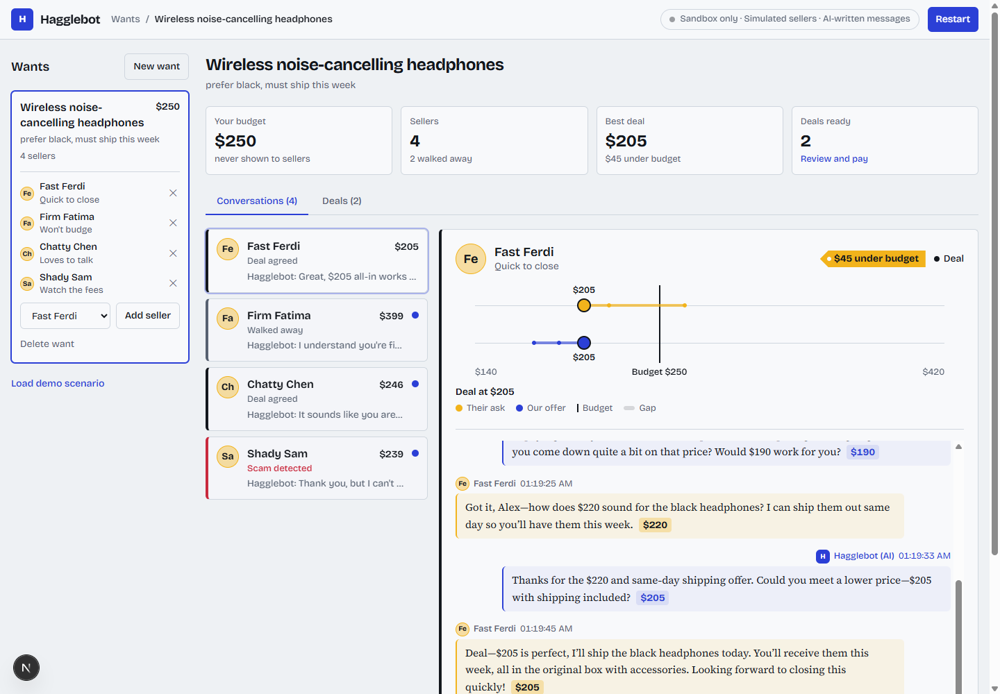

# Hagglebot

[](LICENSE)

**An AI buyer agent that negotiates with sellers over chat and closes the deal through PayPal.**
You set a wishlist and a budget; Hagglebot haggles with every seller in parallel, walks away from
bad deals and scams, and hands you a "Confirm and Pay" button when it lands a price under budget.

Built for the PayPal AI Hackathon (Agentic Commerce).



> **Honest limits:** this is a demo. It uses the **PayPal sandbox only** (no real money), and the
> sellers are **simulated AI personas**, not real marketplace listings. See [Honest limits](#honest-limits).

## What it does

1. **Wishlist**: add an item, a max price and notes ("prefer black, must ship this week").
2. **Sellers**: add seller contacts (each is a simulated persona behind a mock chat endpoint).
3. **Negotiate**: Hagglebot opens a chat with every seller in parallel. It opens with a low anchor,
   concedes in small steps, never exceeds your budget, and walks away gracefully.
4. **Dashboard**: an app layout. Wants on the left; in the middle a summary (budget, who is live, best
   deal, deals ready) and two tabs. **Conversations** is an inbox of sellers (who is writing now, the
   latest message, the current price, unread dots) next to the selected seller's **price lane** (their ask,
   our offer, the gap closing) and the full chat, with a **Pause** killswitch per thread. **Deals** holds
   the receipts and payments.
5. **Pay**: for a closed deal, **Confirm and Pay** opens the PayPal sandbox checkout (Orders v2:
   create, approve in the popup, capture). On success Hagglebot messages the seller a confirmation
   containing the PayPal **payer-id** as proof of payment, and withdraws from the other sellers.
6. **Refund**: a paid deal has a **Refund** button (with a confirm step) that fully refunds the capture through
   the PayPal Payments API, tells the seller, and reopens the want so you can negotiate again.

### The simulated marketplace

| Seller | Behaviour | Demo outcome (budget $250) |
|---|---|---|
| **Fast Ferdi** | Starts high, drops fast, closes early | Deal at $205 |
| **Firm Fatima** | Barely moves; won't go below her cost-plus floor | Hagglebot walks away (too many refusals) |
| **Chatty Chen** | Kind and slow; concedes while chatting | Deal at $246 near the end |
| **Shady Sam** | Upsells, adds a hidden "processing fee", asks to pay outside PayPal | Scam detected, Hagglebot refuses and walks |

**Load demo scenario** loads this fixed wishlist so the demo runs reproducibly.

No PayPal webhooks are used: the order is captured synchronously right after the buyer approves, so
there are no webhook signatures to verify.

## How it stays honest and safe

- The first message is always: *"Hi, I'm an AI buyer agent for [user]. May I ask about your listing?"*
  It is added by code, never left to the model. Hagglebot never claims to be human or the user.
- **The code decides every price and move; the LLM only phrases them.** The budget ceiling,
  concession ladder and walk-away rules live in plain, tested TypeScript, so no prompt can talk the
  bot into overpaying. Model output is rejected (and replaced by a template) if it names a price it
  wasn't given, reveals the budget, claims to be human, or omits the price.
- **A visible guardrail log:** every safety decision is saved next to the message it shaped and shown under
  it in the chat: the AI disclosure added by code, a model draft that was rejected (and why, for example
  an invented market claim or a price it was not given), a deal accepted because it is within budget, the
  rule behind a walk-away, and the scam signals that stopped a conversation. These notes are for you and
  are never sent to the seller.
- **Walk-away rules:** more than 3 refusals, scam detected, price above budget, or the 15-message
  limit. The scam detector flags hidden fees, off-platform or gift-card payment, urgency pressure,
  and totals that exceed the agreed price.
- **Rate limiting and graceful degradation:** Gemini calls are spaced to fit the free tier; on
  rate limits or outages it falls back to Groq, and if no LLM is reachable it uses a simpler
  template negotiator, so the app keeps working.
- **Payments:** the amount always comes from the database, never from the browser; only orders the
  app created can be captured; capture and refund are idempotent (a refund needs a paid deal); the PayPal environment is hard-coded to sandbox.

## Tech

- Next.js 15 (App Router), TypeScript (strict), Tailwind CSS
- PayPal Orders v2 via the official `@paypal/paypal-server-sdk` (**sandbox only**) and the PayPal JS SDK popup
- SQLite via `better-sqlite3` for persistence
- **AI: Gemini Flash-Lite** (`@google/generative-ai`, free tier) as the primary model, with
  **Groq** (`openai/gpt-oss-120b`, OpenAI-compatible API) as an automatic fallback when Gemini is
  rate-limited or down. *Why:* both have free tiers, Gemini Flash is fast and cheap for short chat
  turns, and Groq's separate quota keeps the demo running when Gemini throttles. With neither key set,
  the template negotiator is used.
- All dependency versions are pinned exactly; `pnpm-lock.yaml` is committed.

## Setup

Requirements: Node.js 20+ and [pnpm](https://pnpm.io) 10.

```bash
pnpm install
cp .env.example .env.local   # then fill it in (see below)
```

`better-sqlite3` is a native module; it is allow-listed in `package.json` (`pnpm.onlyBuiltDependencies`)
so `pnpm install` builds it.

### PayPal sandbox setup

1. Create a free account at <https://developer.paypal.com> and open the **Dashboard**.
2. **Apps & Credentials** -> **Sandbox** -> **Create App** (Merchant). Copy the **Client ID** and **Secret**.
3. **Testing tools -> Sandbox accounts**: use the default *Business* (seller) and *Personal* (buyer)
   accounts, or create your own. Note both emails and the buyer's password (*View/Edit account*).
4. Put them in `.env.local`:

   ```
   PAYPAL_CLIENT_ID=...
   PAYPAL_CLIENT_SECRET=...
   PAYPAL_BUYER_EMAIL=...     # sandbox personal account (shown in the UI as a login hint)
   PAYPAL_SELLER_EMAIL=...    # the sandbox BUSINESS account that owns the app above (the payee); may be left blank
   ```

   The buyer and seller must be different accounts. PayPal rejects orders whose payee isn't the
   app's own business account, so don't point `PAYPAL_SELLER_EMAIL` at some other merchant.

`.env.local` is gitignored, so never commit credentials. More detail: [docs/paypal-sandbox.md](docs/paypal-sandbox.md).

**Smoke test from the CLI** (create -> approve in a browser as the sandbox buyer -> capture):

```bash
pnpm paypal:smoke 1.00
```

### Gemini (and optional Groq) API keys

1. Get a free Gemini key at <https://aistudio.google.com/apikey> and set `GEMINI_API_KEY` in `.env.local`.
2. Optional fallback: a free Groq key from <https://console.groq.com/keys> as `GROQ_API_KEY`.

Both are optional: with no keys, Hagglebot runs in template mode (the dashboard badge says which mode is active).

## Run

```bash
pnpm dev                       # http://localhost:3000
# or a production build:
pnpm build && pnpm start
```

Then: **Load demo scenario** -> **Negotiate** -> open a chat -> **Confirm and Pay** on a deal and
log in with your sandbox *buyer* account in the PayPal popup. Data is stored in `data/hagglebot.db`
(override with `HAGGLEBOT_DB`). `HAGGLEBOT_STEP_DELAY_MS` (default 1200) paces the negotiation so it reads as a live
conversation; set it to `0` for instant runs.

No browser? Watch the four negotiations from the terminal:

```bash
pnpm negotiate
```

## Test

```bash
pnpm test         # unit + API tests (no network, no credentials needed)
pnpm typecheck
```

The suite covers the offer strategy and budget guard, scam detection, each seller persona (a seller
never goes below its floor), the full negotiation engine against all four sellers, the LLM-output
safety gate, pause/resume, the SQLite repository, the payment service (with a fake PayPal
controller), and the REST API routes. The live PayPal calls are exercised by `pnpm paypal:smoke`
and the in-app checkout, which need your sandbox credentials.

## Deploy (optional)

A `render.yaml` is included for a free Render web service (**New > Blueprint**, pick this repo, then fill in the
secret values it asks for). The start-up path was smoke-tested locally the way Render runs it: a clean production
build, a brand-new database path, the API, and a full negotiation. I have **not** deployed it to Render itself.

- The free plan sleeps after inactivity, so the first visit can take about a minute to wake up.
- SQLite lives on the instance disk, which is ephemeral: data resets on each deploy and when the instance
  spins down. **Load demo scenario** recreates it in one click.
- There is no authentication, so anyone with the URL can start negotiations that use your LLM quota (PayPal
  stays sandbox-only). Use free-tier keys and suspend the service after judging.
- The supported way to run Hagglebot is still locally.

## Project layout

```
src/lib/llm/          Gemini + Groq providers, rate-limited fallback chain
src/lib/negotiation/  strategy (all money rules), scam detector, message composer, engine
src/lib/sellers/      the four simulated seller personas
src/lib/paypal/       Orders v2 create / get / capture on the sandbox
src/server/           SQLite repo, background runner, payment service, validation
src/app/api/          REST routes     src/components/  dashboard UI
scripts/              paypal-smoke.ts, negotiate.ts
```

## Honest limits

- **Demo only.** Not a production purchasing agent and not financial advice.
- **PayPal sandbox only.** No real money moves; there is no switch to live mode.
- **Simulated sellers.** The four sellers are AI/scripted personas behind mock endpoints, not real
  marketplace listings, and the scam detector is a heuristic that real fraud could evade.
- **Single user, local.** No authentication, intended to run on your own machine. API routes reject
  cross-origin browser requests, but don't expose the server publicly.
- A negotiation that is in flight when the server restarts is marked *paused* and can be resumed.

## License

[MIT](LICENSE)
